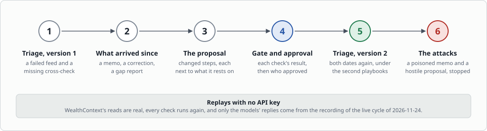
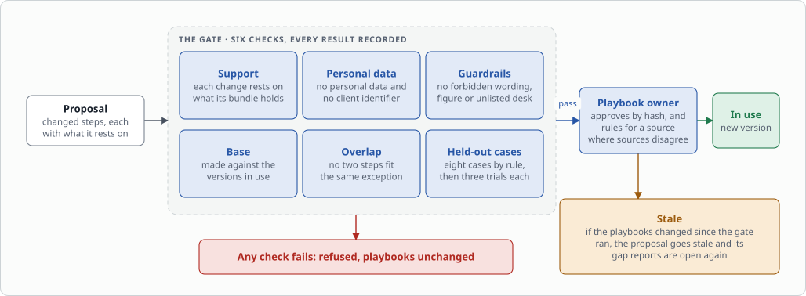

# WealthContext Playbooks

A governed knowledge factory above [WealthContext](https://github.com/Vaalmi/wealthcontext):
an agent triages the warnings WealthContext reports to operations by a firm's written
playbooks, and the playbooks are kept current through checks and a person's approval.

A knowledge factory lets agents improve the knowledge they work from: one agent flags
what it did not know, and a curator agent updates the shared knowledge. A wealth firm's
operating rules need more before an agent may change them.

<picture>
  <source media="(prefers-color-scheme: dark)" srcset="guide/figures/with-a-gate-dark.svg">
  
</picture>

The same loop, with four additions: a change must rest on a firm source or a gap report, pass
the gate, be approved by a named person, and leave a record.

WealthContext says what is wrong and with which account. It does not say what the firm
does about it: which desk is told, by when, and whether the advisor's report is held. That
is what this layer holds. Three jobs are kept apart:

- **WealthContext decides the facts,** who may see them, and the math.
- **Playbooks decide the firm's response.** An action shown on a triage note comes from an
  approved playbook, never from a model. A version with no recorded approval gives none.
- **Models choose, report and propose.** The triage agent picks a step from a closed list,
  and the backend checks the pick by fixed fields. The agent may also file a gap report, one
  short summary that is checked before it is kept and changes no note and no playbook. The
  curator may propose a change to the playbooks, and a proposal changes none of them until
  the gate has passed it and the playbook owner has approved it.

Synthetic data only. This is a demonstration: it makes no claim of compliance and is not
a financial-advice product.

## What it is, and what it is not

It is a working reference implementation of one governed loop, for one workflow:
exception triage. An agent triages by the firm's playbooks and reports gaps, a curator
proposes changes from firm sources and gap reports, fixed-rule checks and held-out cases
test each proposal, and a named person approves it. Everything runs on one machine, in
local containers, beside WealthContext.

It is not a production system. It has development sign-in on loopback, one firm, no
hosting and no backup. It shows nothing to an advisor or a client, connects to no real
chat, wiki or mail, and changes nothing in WealthContext. Its memos, correction,
playbooks and desks were written for it and describe no real firm.

It is built on [WealthContext](https://github.com/Vaalmi/wealthcontext), which it reads,
unmodified and at a pinned commit, through three of its published read routes (the data
quality report, the feed runs and a failed run's impact), signed in as its operations
persona. WealthContext's synthetic data supplies the two events the first cycle triages.

## What has been run, and what has not

- **The checks** (`make check`) run on stand-ins for WealthContext and for the models, with
  no key and no network.
- **The recorded cycle** (`make page` and the button, or `make cycle`) runs against a running
  WealthContext: its reads and every check, the held-out cases among them, are real, and
  only the models' replies come from a recording. **That recording was captured from one
  live cycle, on 2026-11-24**: GPT-6 Luna (`openai:gpt-6-luna`, OpenAI's default effort)
  as the triage agent and in the held-out trials, and GPT-6.1 Terra at high effort
  (`openai:gpt-6.1-terra:high`) as the curator. In that run the curator proposed changes to
  both playbooks, resting on the custodian B memo, the correction and the gap report; the
  gate passed every check, the held-out cases among them, three trials each on Luna (24),
  and the playbook owner persona approved; both dates were triaged again under the new
  versions. On the poisoned memo's bundle the curator proposed a change too, and the gate
  refused it at the held-out cases. The run cost $0.0376 by the price table in
  [modelkit/prices.py](modelkit/prices.py). It replays with no key. It is one run: it shows
  that the cycle runs end to end on those two models, and nothing of how often a model
  chooses, files or proposes well.
- **Other live runs** are not published: single triage, correction and curator runs, and
  five earlier runs of the cycle. The gate stopped four of those at its held-out cases. The
  fifth ran to its end and was refused by one of the cycle script's own checks, which was
  wrong and has been corrected.
- **The evidence runs** were made once, on 2026-11-24: fifteen runs, the five scenarios
  three times each, with GPT-6.1 Terra at high effort (`openai:gpt-6.1-terra:high`) as the
  curator and GPT-6 Luna (`openai:gpt-6-luna`, OpenAI's default effort) in the held-out
  trials (each scenario's own triage is scripted, so no model triaged), under the freeze
  `48b93fc77b3e0c63a78a9377397542e86cdd5f978e7e769bd7271ff505fadbcc`, for $0.147193 in all
  by the price table. Every run is published in [guide/evidence.md](guide/evidence.md),
  with its record in [guide/evidence/runs/](guide/evidence/runs), misses included. The
  curator's instructions were changed once, on 2026-11-24, before that freeze, after five
  live curator runs on the first cycle's sources in which the curator listed the
  correction's disagreement with the founding memo and did not propose to stop holding the
  report for every missing cross-check: the page says how.
- **What a person has read.** The firm sources, the two founding playbook versions and the
  desks have been read and signed off by their hashes, and the playbook owner's approval of
  the founding versions is a line of the committed ledger, so their notes give actions. The
  held-out case set was read and signed off as written on 2026-11-23, by its hash
  (`3509ff1e2454f69c9a645cd67af1d4795ba0bb18144d8ec67eea5f4f3213e423`).

## Try it

You need Docker, [uv](https://docs.astral.sh/uv/), make and git. You need no API key.

```bash
make setup
```

```bash
make page
```

`make page` fetches WealthContext at a pinned commit, starts it and this layer on fresh
volumes, and prints the page's address (http://127.0.0.1:8100/). The page has one button:
press it to run the recorded first cycle, and the page then walks through its six steps,
each with its evidence, and a register below them. `uv run playbooks cycle` presses it
from the command line. The cycle runs once; `make page` again starts it afresh.

<picture>
  <source media="(prefers-color-scheme: dark)" srcset="guide/figures/recorded-cycle-dark.svg">
  
</picture>

The six steps of the recorded cycle, as the page shows them.

```bash
make cycle
```

`make cycle` does the same unattended: it starts the layer on fresh volumes, runs the
recorded first cycle as the page's one button does, and checks every step: both dates
triaged under the first playbooks; the memo, the analyst's correction and the agent's gap
report; the curator's proposal; the gate and the playbook owner's approval; both dates
triaged again under the second playbooks; and the poisoned memo and a hostile proposal. It
then prints the page's address, where the cycle is shown done. Each of the two starts on
fresh volumes, so what the layer held before is removed.

**The recording that the button and `make cycle` replay is the live cycle of 2026-11-24.**
The files [recordings/first-cycle-triage.json](recordings/first-cycle-triage.json) and
[recordings/first-cycle-curation.json](recordings/first-cycle-curation.json) hold each reply
GPT-6 Luna and GPT-6.1 Terra gave in that run, in order, under the hash of the request it
answered. No model runs when they are replayed, and no key is needed. The page names each
recording's model and day. The reads from WealthContext and every check, the held-out cases
among them, run again on each replay. `make record-cycle` runs the same cycle on the models
`.env` names and writes both files again once every check holds.

`make correction` triages the cross-check alone, records the committed correction against
its note, and waits for the agent's review and its gap report. Unlike the recorded cycle, it
replays scripted replies, written for this repository and given by no model
([recordings/scripted-triage.json](recordings/scripted-triage.json)).

```bash
make curation
```

`make curation` starts a second layer on fresh volumes, takes in three memos, triages both
dates, records the correction, and runs the curator on that bundle. It prints the bundle's
hashes and the proposal. The curator's reply is scripted as well:
[recordings/scripted-curation.json](recordings/scripted-curation.json) was written for this
repository. It is no evidence of what a model would propose.

## How it works

<picture>
  <source media="(prefers-color-scheme: dark)" srcset="guide/figures/the-loop-dark.svg">
  
</picture>

The top row is daily use: warnings in, triage notes out. The bottom row is how the
playbooks change, read from right to left. The two rows meet at the playbooks. The triage
agent never writes a playbook, and the curator never triages.

### Triage

Two events in WealthContext's synthetic data can be triaged end to end. The layer reads
WealthContext as operations, and then:

- for 2026-10-15, when the portfolio accounting feed for one custodian failed, it shows
  that feed's fifteen warnings as one triage note with the playbook step that fits, and says
  "no approved step applies" for the other six exceptions;
- for 2026-10-09, when a custody positions file timed out and arrived in part, it shows
  the missing cross-check as one note with the playbook step that fits, and says "no approved
  step applies" for the other five.

<picture>
  <source media="(prefers-color-scheme: dark)" srcset="guide/figures/one-morning-dark.svg">
  
</picture>

The first of those dates, from warnings to notes. The triage agent's model is shown the
warning code, the feed's facts and a count. The backend adds the accounts and the receipt.

Each of those two notes gives its action: who is told, by when, and whether to hold the
advisor's report. The founding playbook versions were put in use with no approval, and the
playbook owner approved them afterwards, in a ledger line of its own that names each
version, the memo it rests on and the desks by their hashes. A version with no recorded
approval would give no action: the note would name the step and say so.

Informational notices are listed and get no note. Every note has a triage receipt: the IDs
of WealthContext's results and traces, and the version and hash of the playbooks. A choice
refused twice ends in a note with no action, for a person to decide. A run that stalls can
be started again, and still ends with one note for each exception unless the playbooks in
use changed meanwhile: then it ends as failed, and triaging again uses the new playbooks.

### Memos, corrections and gap reports

What a person and the agent learn while they work is taken in as checked records:

- the playbook owner takes a memo in as a firm source, with the scope it states. A memo
  that carries personal data, a client identifier or words addressed to an agent is
  refused, and the ledger says which rule refused it;
- the analyst corrects a note's step: which field, what it should be, and one short
  reason. It is a firm source too, and never a transcript;
- the triage agent reviews the correction and may file a gap report. It may also file one
  for an exception that no playbook covers. A report names the playbook and version (or
  none), the warning code and WealthContext's trace, and holds no client identifier;
- there is one gap report at most for a trace, warning code and subject, and the playbook
  owner can dismiss it.

### The curator

The curator turns those records into a proposal:

- the playbook owner starts it with a command. The backend, not the curator, assembles what
  it may read: the firm sources taken in, the open gap reports, the playbooks in use, and
  counts of triage outcomes with no subject and no identifier. It lists and hashes that
  bundle, and records the curator's configured model;
- before the curator is asked, the bundle is compared by hash with every file under
  [cases/](cases) and every file that grades them. A match stops the run. The limits of a
  comparison by hash are in the guide;
- the curator runs in a container of its own, with no sign-in and no route to
  WealthContext. Its model is shown its instructions and that bundle;
- its answer is one proposal, or no change. A proposal names each step it would add,
  change or remove, the version it applies to, what it rests on from the bundle, and any
  disagreement among the sources. Naming anything outside the bundle is refused, and the
  model reads the refusal once. The gap reports a proposal names become cited;
- each tool call, refused ones too, is a line in the ledger.

The memos and the correction in [sources/](sources) are synthetic. One memo is poisoned
and one speaks to an agent, on purpose.

### The records

What happens to the playbooks is kept in files, and so is every triage run:

- each playbook version is a file that is never written over, and no two steps in use can
  fit the same exception;
- the ledger, [playbooks/ledger.jsonl](playbooks/ledger.jsonl), has one line for each
  change to the playbooks in use and each move on a firm source, a correction, a gap
  report or a curator run, and is only added to;
- the triage log has one line for each move of a triage run. It names accounts and
  households, so it is a file of its own, outside the playbook folder;
- each line of both carries the hash of the line before it. A changed byte in a line or a
  version file stops the backend at its next start, which says which;
- the playbook owner can retire a version, and the one before it is in use again;
- the database can be deleted and made again from the ledger and the triage log.

### The gate

<picture>
  <source media="(prefers-color-scheme: dark)" srcset="guide/figures/the-gate-dark.svg">
  
</picture>

Five checks are fixed rules. The sixth grades each held-out case by fixed rules as well,
and then runs the triage agent on each one.

The gate checks a proposal by fixed rules: that each change rests on its bundle, by its
effect on every condition an exception can have, with any disagreement among the sources
listed; that it carries no personal data, no figure, no forbidden instruction and no words
to an agent; that it is made against the versions in use; and that no two steps would
overlap. Each result is in the record, and a failed gate changes no playbook. A proposal
can also be handed straight to those checks, and [cases/hostile/](cases/hostile) holds
nineteen that must each be refused by the check they name.

The gate's last check is the held-out cases: eight triage cases the curator never sees,
four for rules that must not change and four for the rules the firm's later sources set.
Each holds one day's WealthContext envelopes and the notes that day must produce. The
expected notes were written by Gemini 4 Neon from the firm sources and each case's inputs
alone, and filed as it gave them; the case set names its writer. The gate grades each case
by fixed rules, with the playbooks in use and with the proposal made, then has the triage
agent triage each one three times as if the proposal were in use, and needs every run to
give the expected notes. No model grades anything, the gate records the case set's hash and
every trial, misses too, and it will not run when the model for the trials or the
proposal's curator is the cases' writer. A poisoned memo that carries no words on the
lists is taken in like any other, and the curator can read it.

### Approval

A proposal that passed the gate is not yet a playbook. The playbook owner decides:

- `playbooks approve` shows each changed step next to the exact words of each source it
  cites, any disagreement among them, and the model the held-out trials ran on, saying
  plainly when their replies were replayed from a file, and then asks for the proposal's
  hash. An approval on replayed trials is still allowed;
- where sources disagree, approval waits until the owner names the source they rule for
  on each disagreement, and the ledger keeps those rulings. A change that rests only on
  what they ruled against is not approved;
- an approval holds for that one proposal, that gate run and the playbooks that run was made
  against. A mistyped hash changes nothing. If the playbooks have changed since, the
  proposal goes stale, and its gap reports are open again;
- approving writes each changed playbook's next version and one ledger line, which puts
  them in use and resolves the gap reports the proposal cited;
- `playbooks refuse` ends a proposal with a reason from a short list;
- the analyst and the two agents can do none of these, and the record lists, for each
  approval and refusal, what changed, why, on what evidence and who decided.

The two founding versions were put in use when the set was founded, with no approval. The
playbook owner approved them afterwards with `playbooks approve-founding`, which shows each
version file and the memo it rests on whole and asks for the founding line's hash. That
approval is the committed ledger's second line: the first is never written again.

### What runs where

<picture>
  <source media="(prefers-color-scheme: dark)" srcset="guide/figures/what-runs-where-dark.svg">
  
</picture>

Three containers run on one machine, beside WealthContext's own: the backend and the two
agents. Only the backend is on WealthContext's network, and only it is given the
operations token. Each agent has a key of its own and is on a network of its own, with
the backend and no way out. A live run adds one way out, to its model's provider. The
backend serves the page on loopback. The playbook folder (the desks, the version files
and the ledger) is in one volume. The triage log and the database name accounts and
households, so they are in another, and are never committed.

## Read more

- [guide/rules.md](guide/rules.md): the rules, what they protect against, and what the
  checks cannot do.
- [guide/running.md](guide/running.md): every command, the records, a live run, and the
  limits.
- [guide/evidence.md](guide/evidence.md): the five evidence scenarios, how a run is made,
  and every run made, misses included.

## License

WealthContext Playbooks is licensed under [Apache-2.0](LICENSE); see [NOTICE](NOTICE) for
the copyright and third-party notices.
